# Staff documents (round V1b-1)

Captured from the Flutter app compiled for the browser (390×844) and the website (1366×900), against the local backend. The document images are made-up samples marked SAMPLE.

## Staff add their own

| | | |
|---|---|---|
| 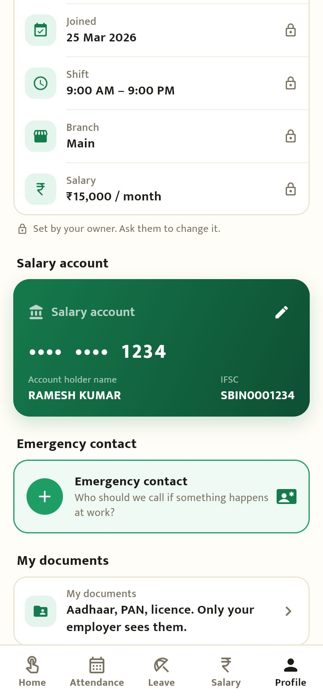 Profile → My documents | 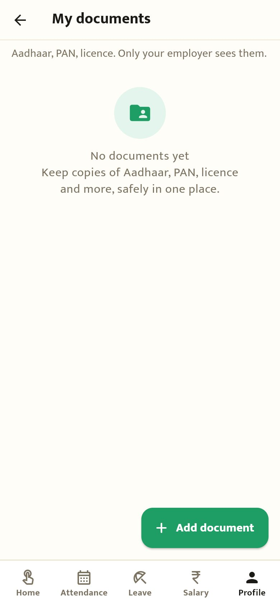 Nothing yet | 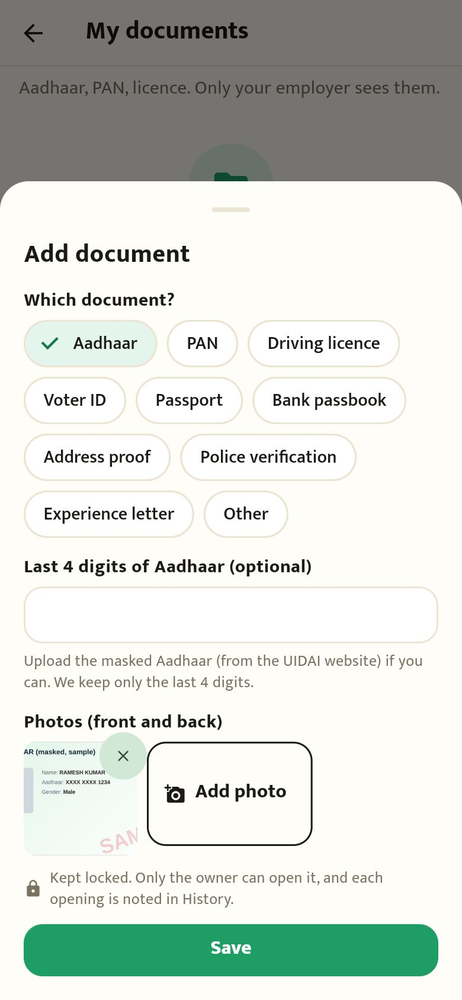 Pick the document, a photo; for Aadhaar only the last 4 digits |
| 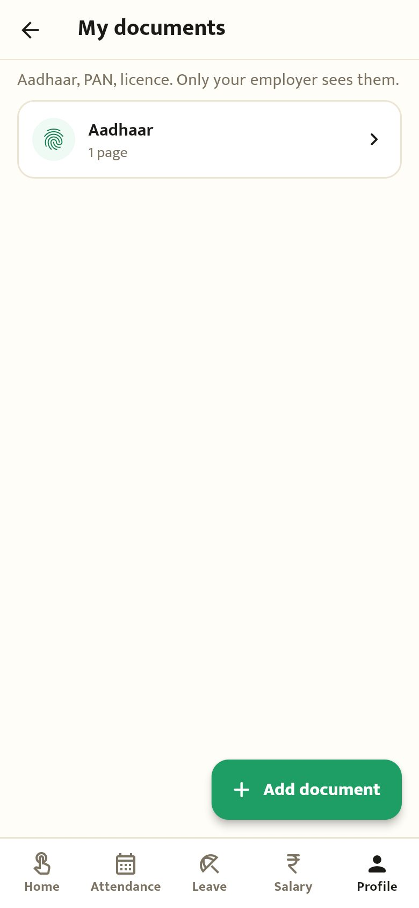 Saved | | |

## Owner

| | | |
|---|---|---|
| 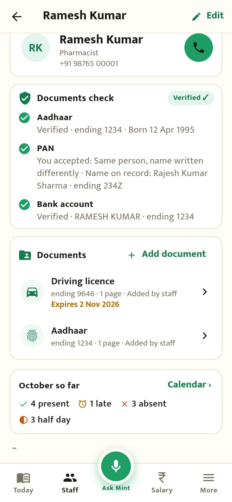 Staff profile: documents check results, then Documents with the licence expiring soon | 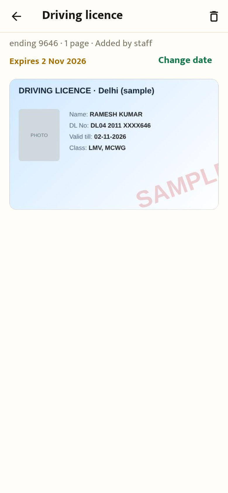 Opening a document (written to History) | 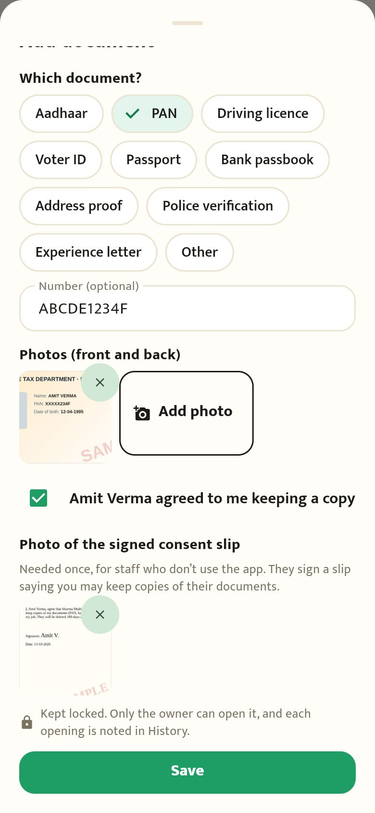 For staff without the app: "they agreed" and a photo of the signed slip the first time |
| 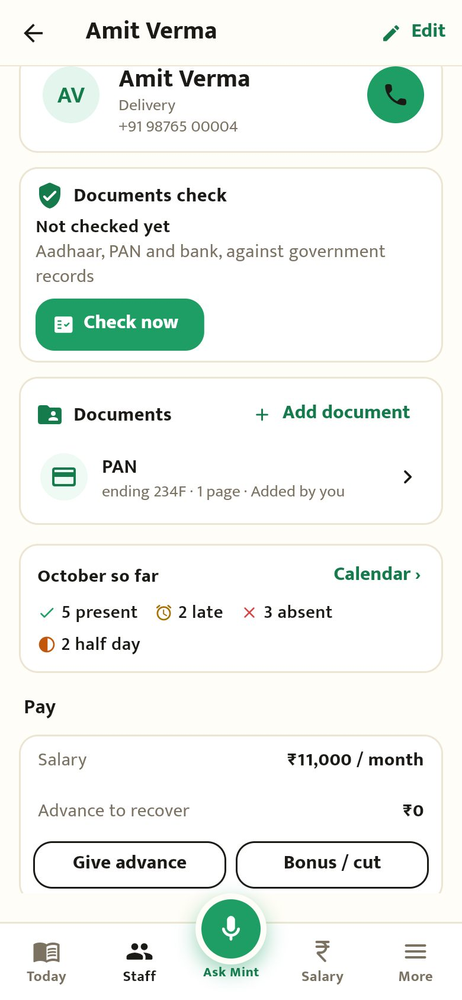 Saved, "Added by you" | 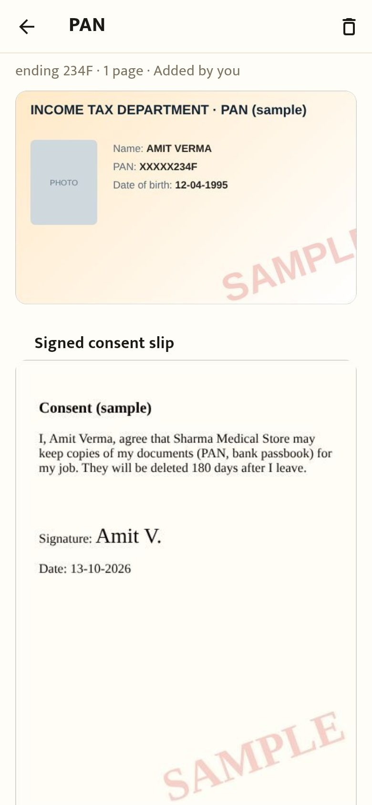 The document and its signed slip | |

## Hindi

| | |
|---|---|
| 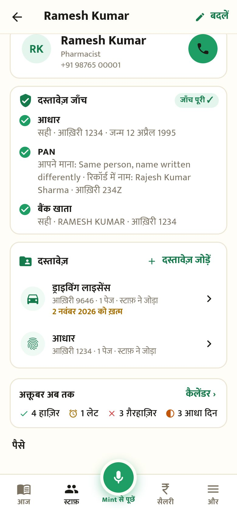 स्टाफ़ प्रोफ़ाइल → दस्तावेज़ | 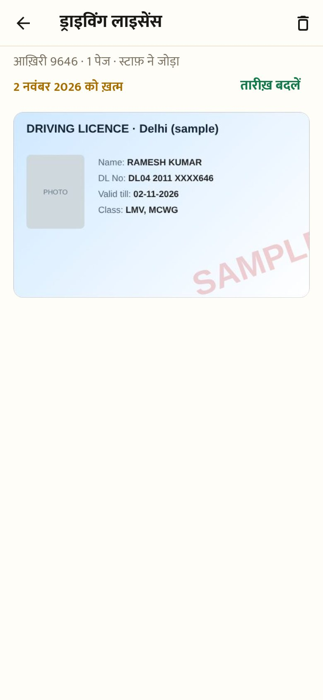 दस्तावेज़ खोलना |

## Website

| |
|---|
| 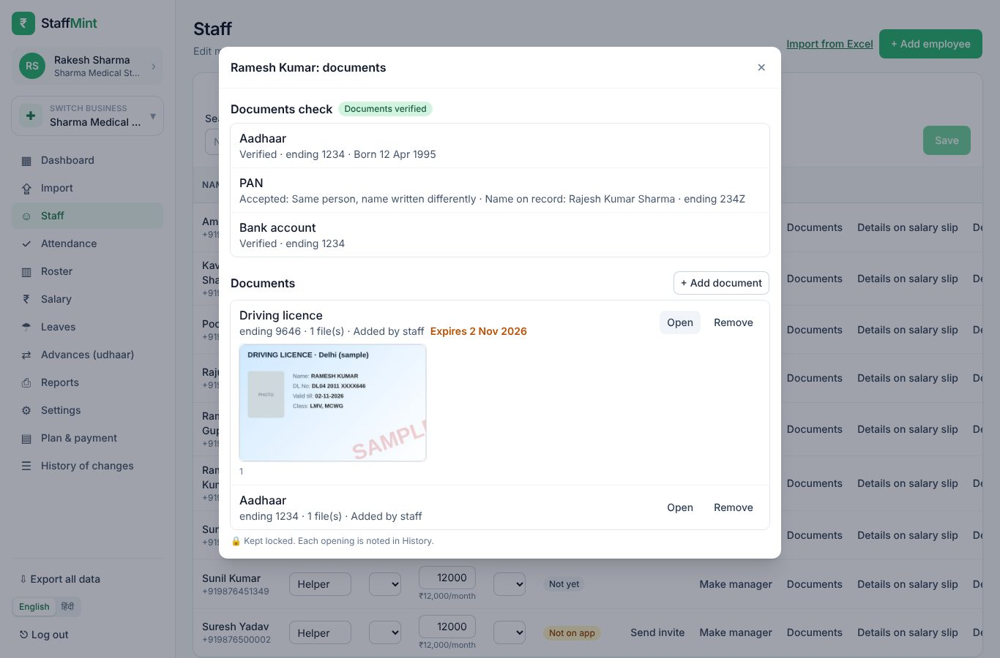 Staff → Documents: the documents check results and the documents, with a preview |
| 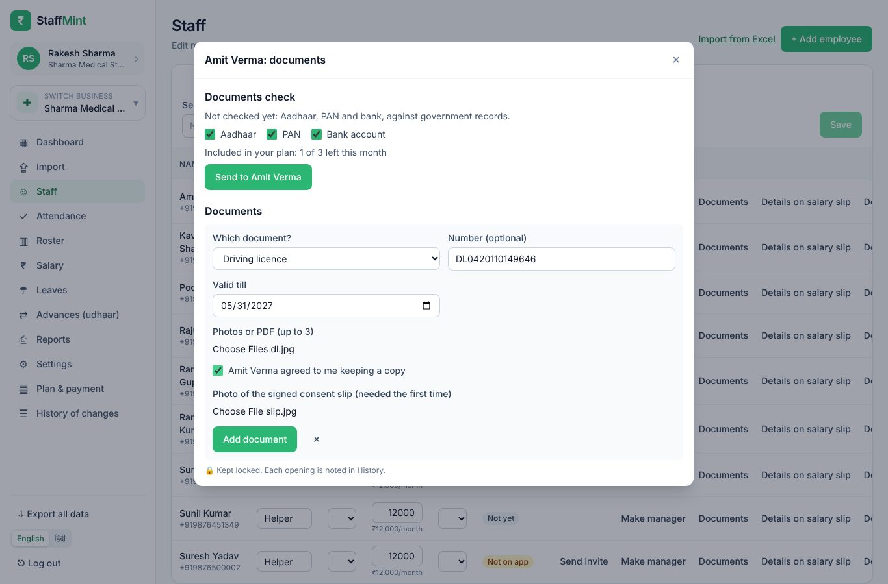 Adding a licence with its valid-till date, "they agreed" and the signed slip |
| 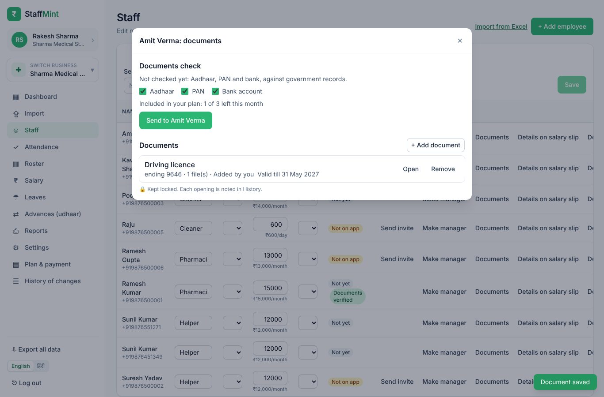 Saved |
| 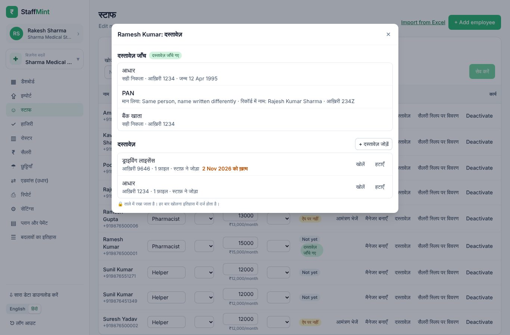 हिंदी में |
