# Selfie check and "Do it with them" (round V1b-2)

Captured from the Flutter app compiled for the browser (390×844) and the website, against the local backend with the mock verification and face providers. Document, slip and selfie images are made-up samples.

## Staff: selfie vs the photo on their ID

| | | |
|---|---|---|
| 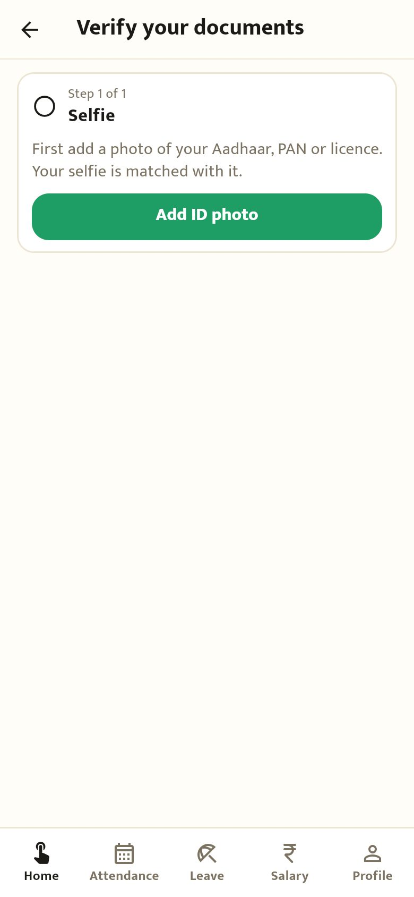 No photo ID yet: add one right here | 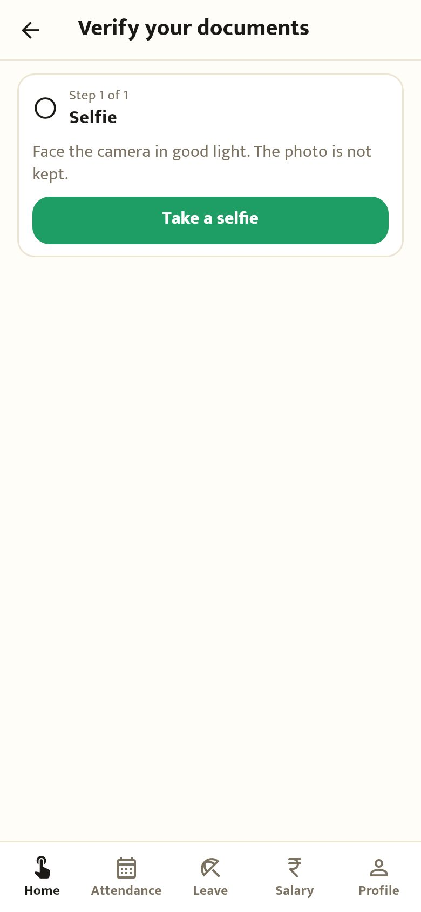 Take a selfie (not kept) | 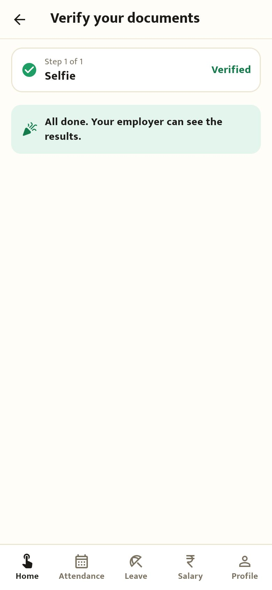 Verified |

## Owner: doing it with someone who has no smartphone

| | | |
|---|---|---|
| 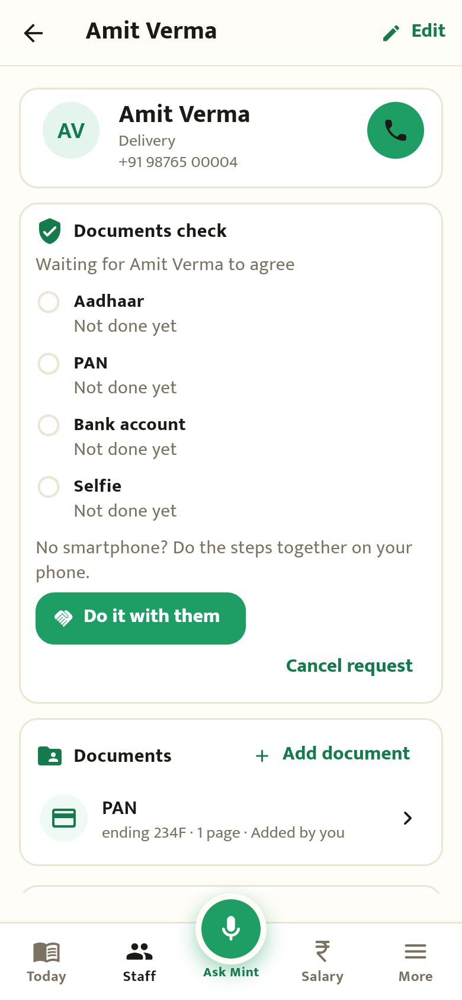 "Do it with them" on the documents check card | 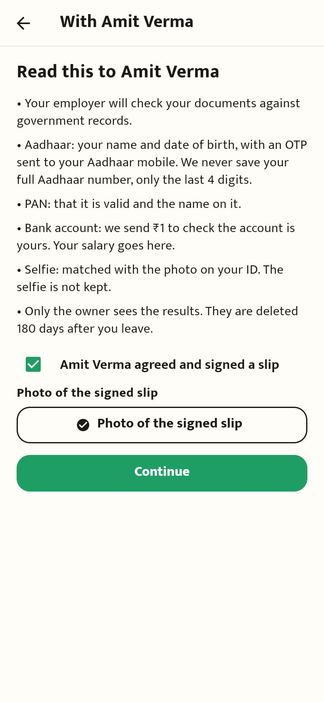 Read it to them, tick, photo of the signed slip | 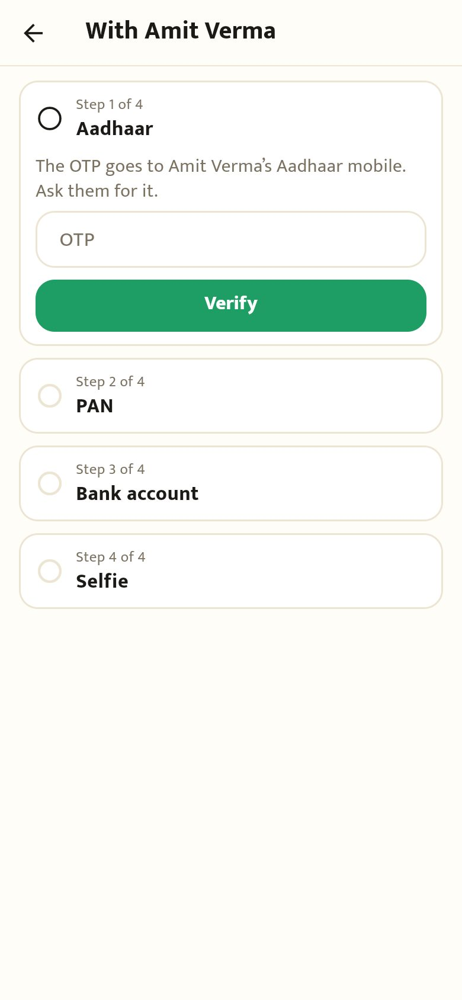 The OTP comes to their Aadhaar mobile |
| 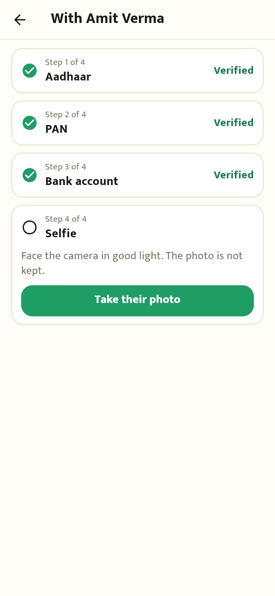 Take their photo | 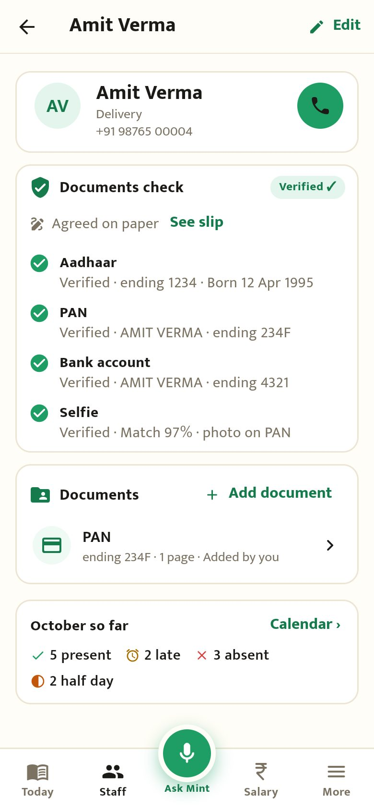 Results: "Agreed on paper · See slip", selfie match 97% with the PAN photo | 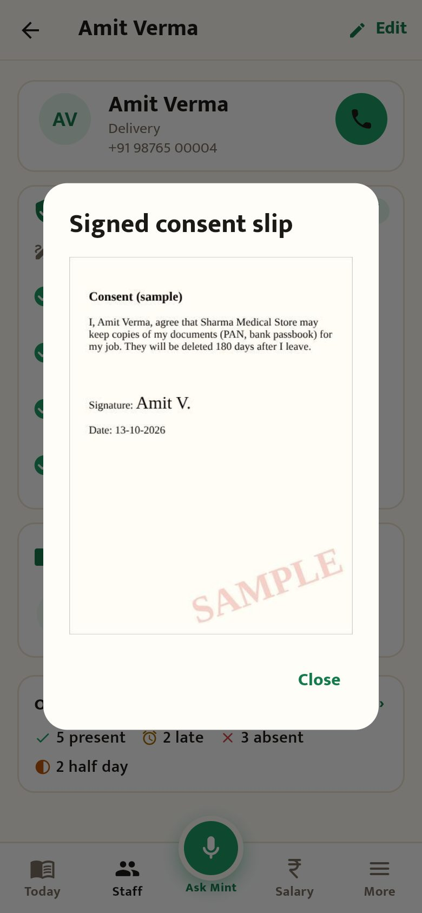 The signed slip (opening it is in History) |
| 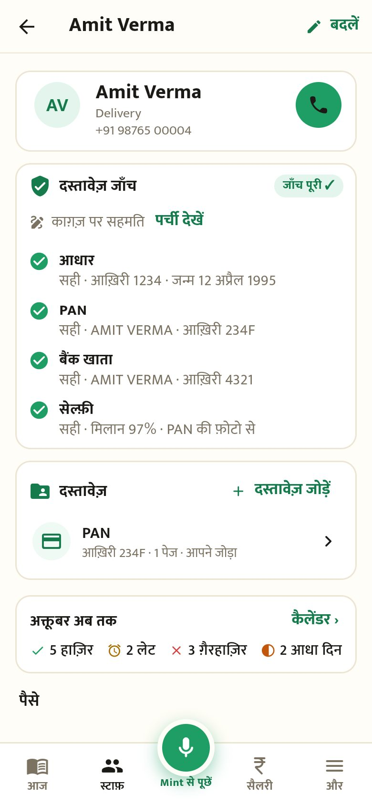 हिंदी | | |

## Website

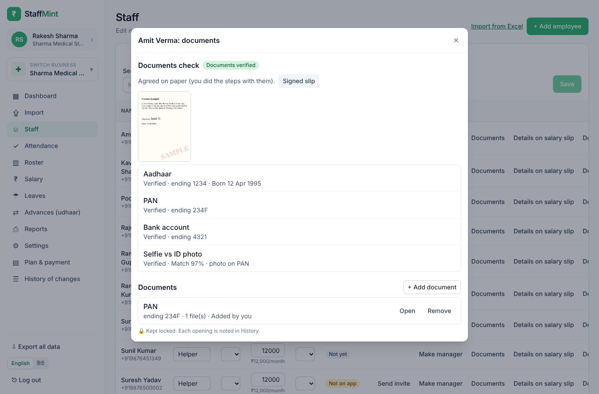 Staff → Documents: agreed on paper with the slip, and the selfie result
