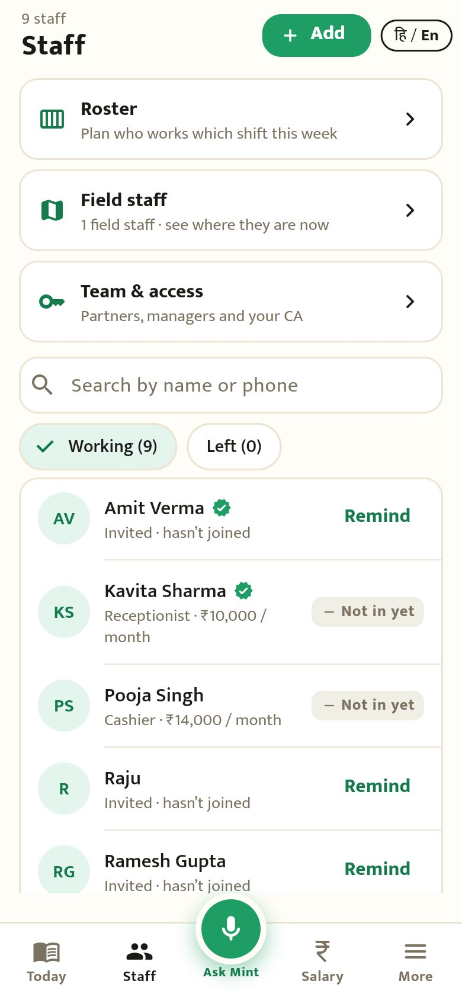
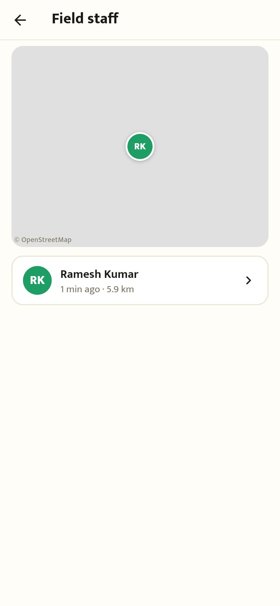
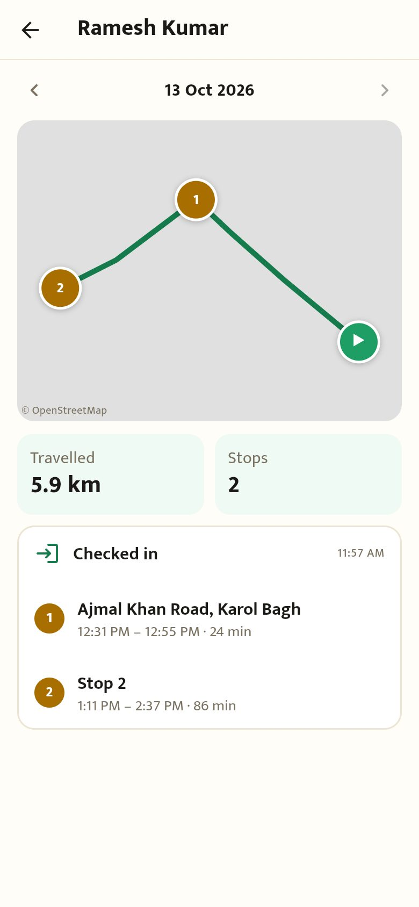
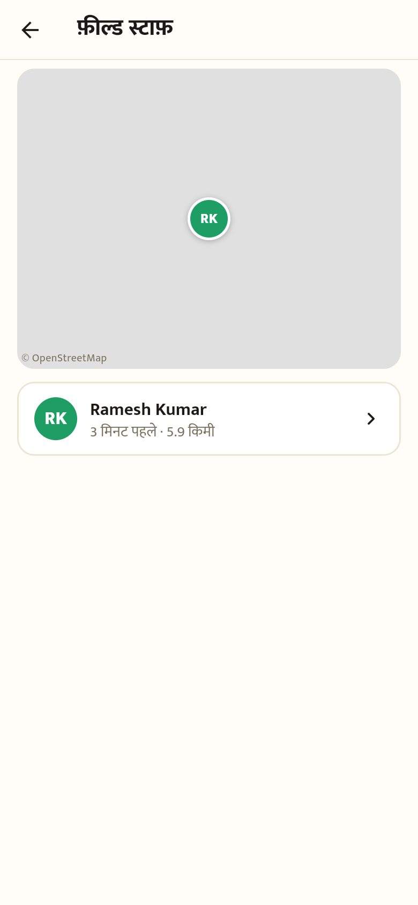
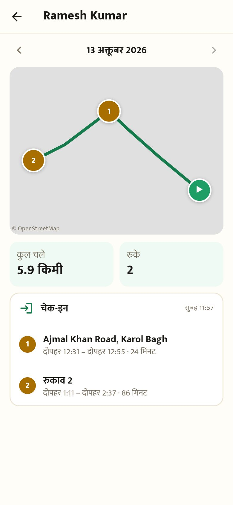

# Field staff location (round T1a)

Captured from the Flutter app compiled for the browser (390×844) against the local backend, with the browser's location set to Karol Bagh.

## Owner

| | |
|---|---|
|  Staff profile → "Field staff: share location during shift" |  Turned on: waiting for them to agree |

## Staff

| | | |
|---|---|---|
|  Home: the owner asked |  Consent in plain words (also the Play Store disclosure) |  Checked in: "Sharing location until you check out" |
|  Profile: on while checked in, "Stop sharing" | | |

## Round T1b: where they are, and their day

The map pictures are grey here because the sandbox can't load map tiles; on phones with the Google Maps key (or a tile key for the fallback map) the streets show underneath.

| | | |
|---|---|---|
|  Staff tab → "Field staff" |  Initials at their last point (green: under 5 minutes), "3 min ago · 5.9 km" |  Their day: route, stops with place and minutes, km |
|  हिंदी: फ़ील्ड स्टाफ़ |  हिंदी: दिन का रास्ता | |
