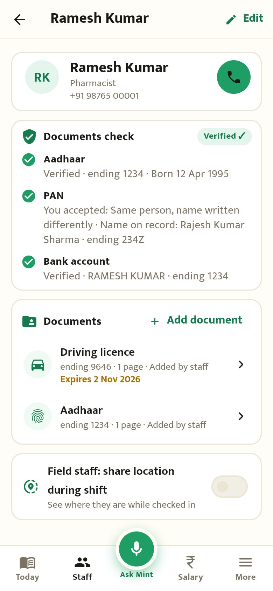
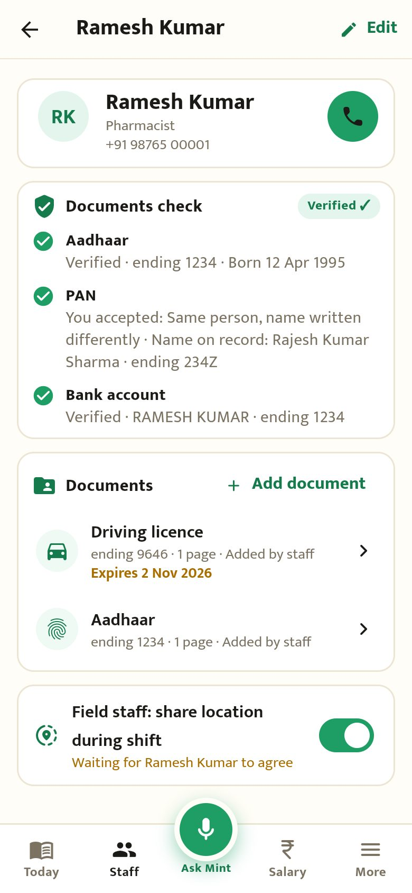
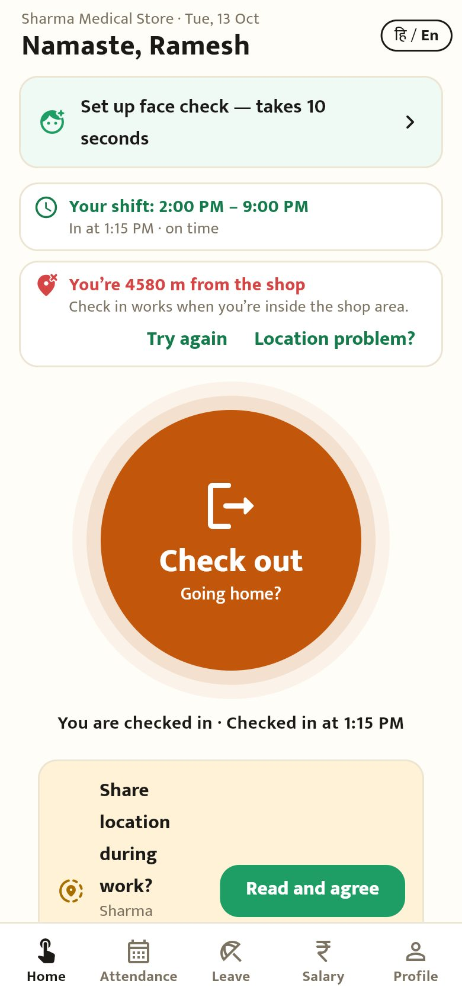
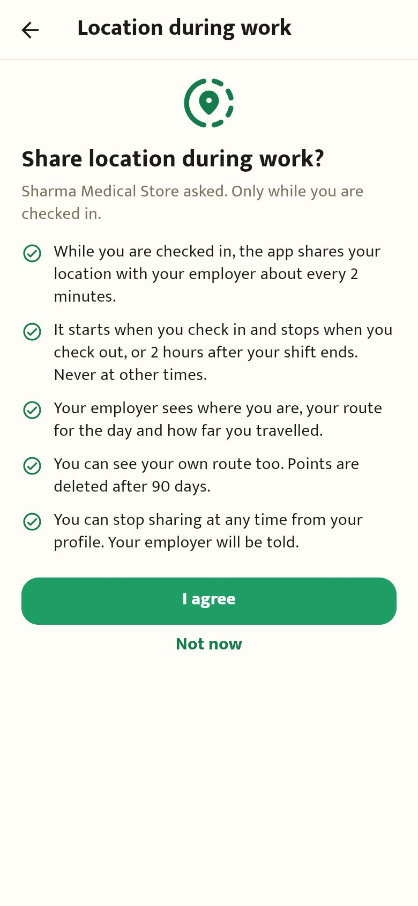
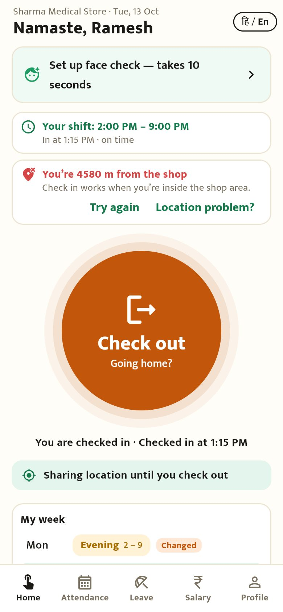
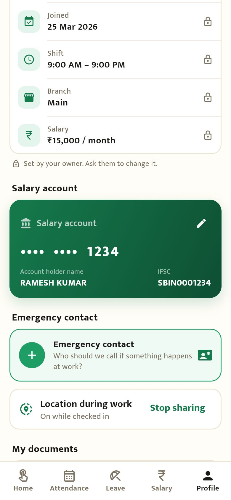

# Field staff location (round T1a)

Captured from the Flutter app compiled for the browser (390×844) against the local backend, with the browser's location set to Karol Bagh.

## Owner

| | |
|---|---|
|  Staff profile → "Field staff: share location during shift" |  Turned on: waiting for them to agree |

## Staff

| | | |
|---|---|---|
|  Home: the owner asked |  Consent in plain words (also the Play Store disclosure) |  Checked in: "Sharing location until you check out" |
|  Profile: on while checked in, "Stop sharing" | | |
