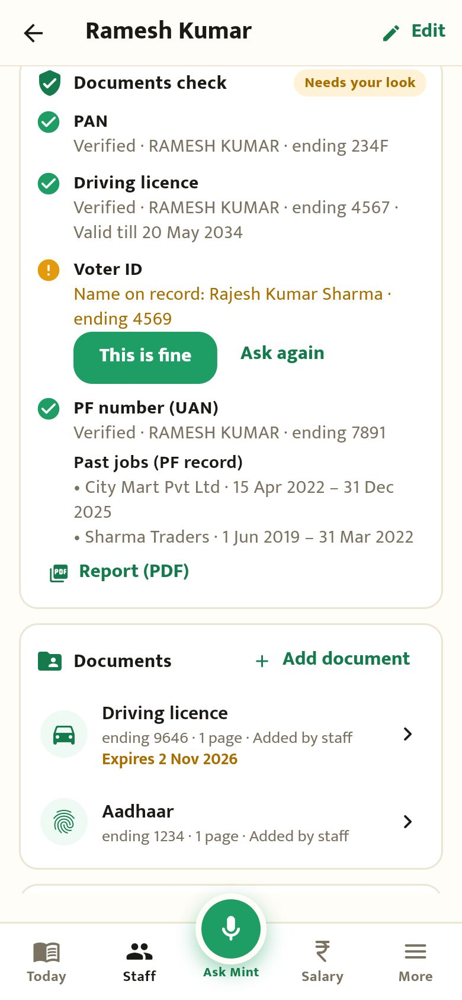
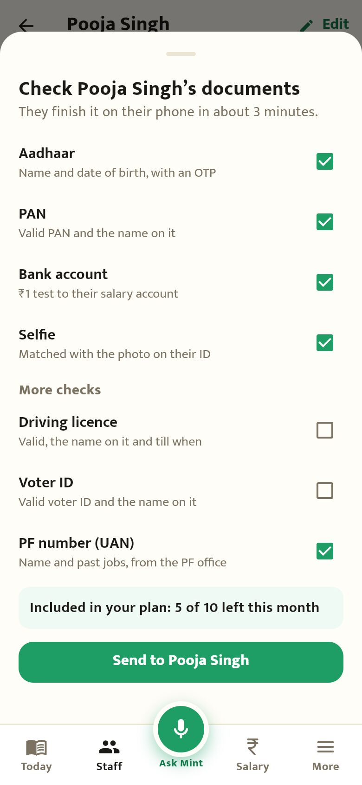
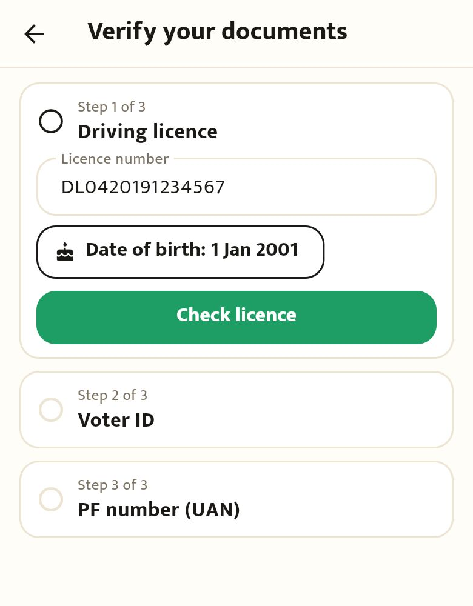
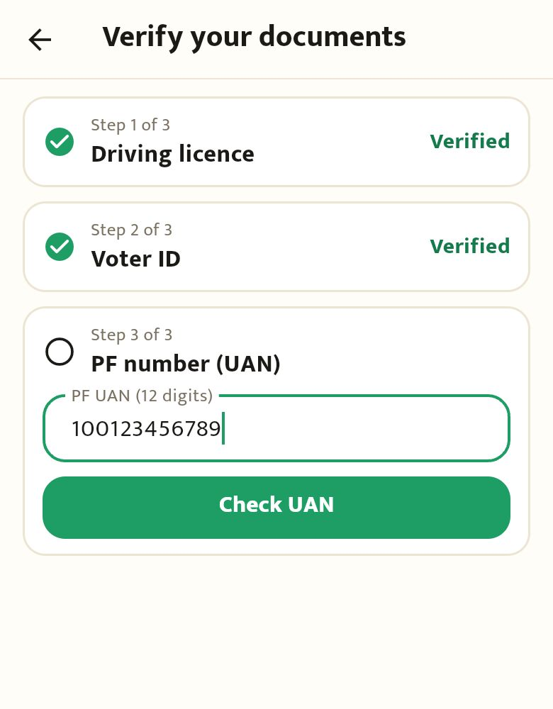
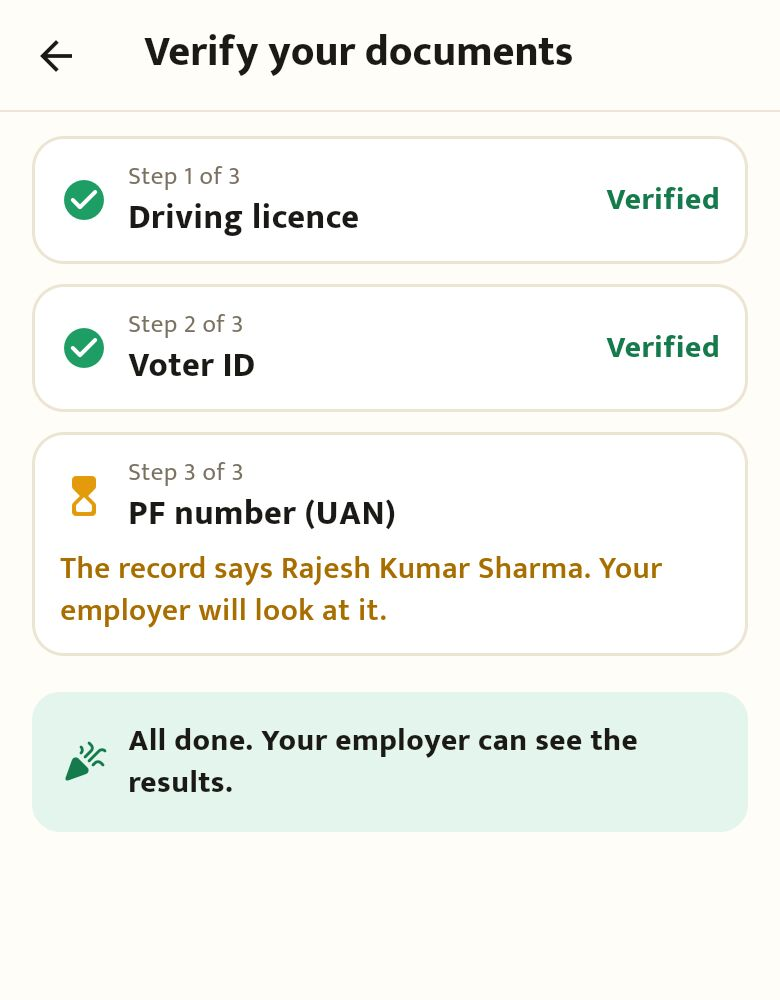
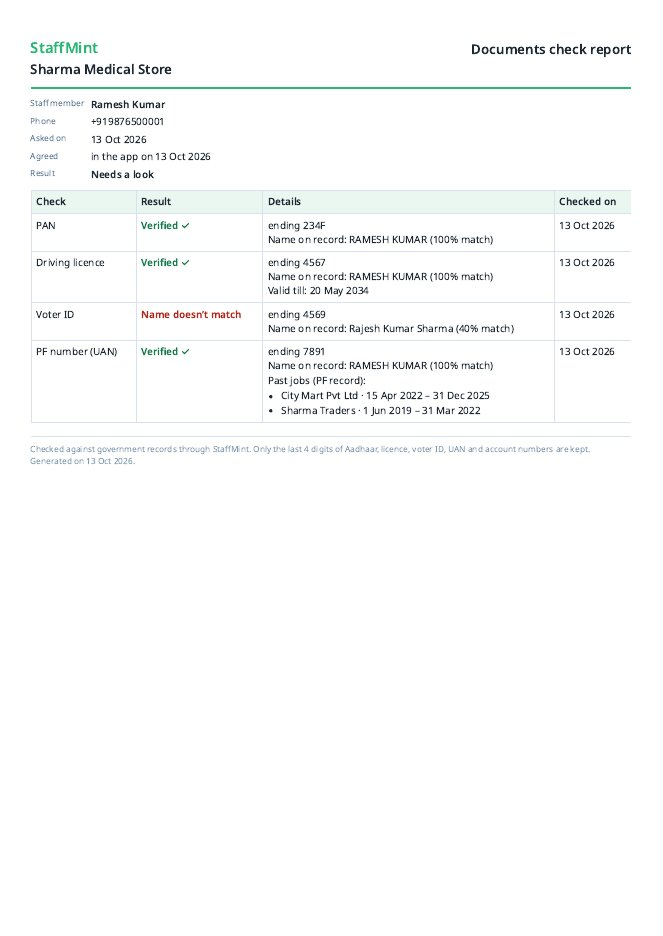
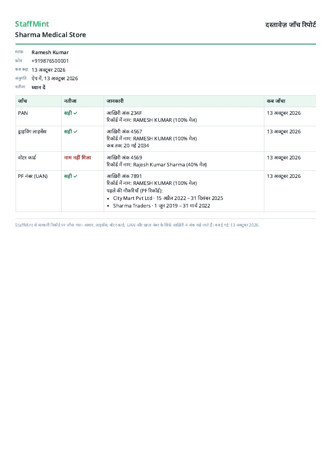
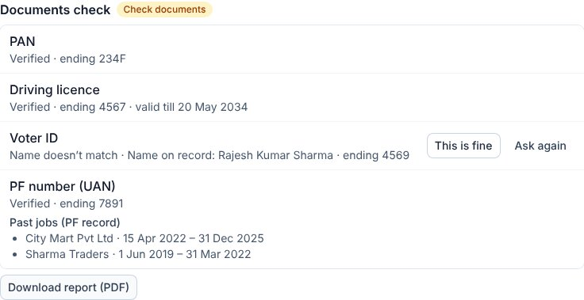

# Driving licence, voter ID, UAN and the report (round V2a)

Captured from the Flutter app compiled for the browser (390×844) and the website, against the local backend with the mock verification provider. The report was rendered with `PDF_PROVIDER=puppeteer`. Names, numbers and past employers are made-up samples.

## Owner

| | |
|---|---|
|  Results: licence valid till, a voter ID under another name ("This is fine" / "Ask again"), past jobs from the PF record, Report (PDF) |  "Check now": licence, voter ID and UAN under "More checks", not ticked to begin with |

## Staff

| | | |
|---|---|---|
|  Licence number and date of birth |  UAN (or "Use UAN ending 7891" when it's in their profile) |  Done; a name that doesn't match goes to the owner |

## Report (PDF)

| | |
|---|---|
|  |  |

## Website

 Staff → Documents: the same results, past jobs and "Download report (PDF)"
