# Documents check (background verification, round V1a)

Captured from the Flutter app compiled for the browser (390×844) against the local backend with the mock verification provider (OTP `123456`; a PAN ending in "Z" belongs to someone with another name).

## Owner asks

| | | |
|---|---|---|
| 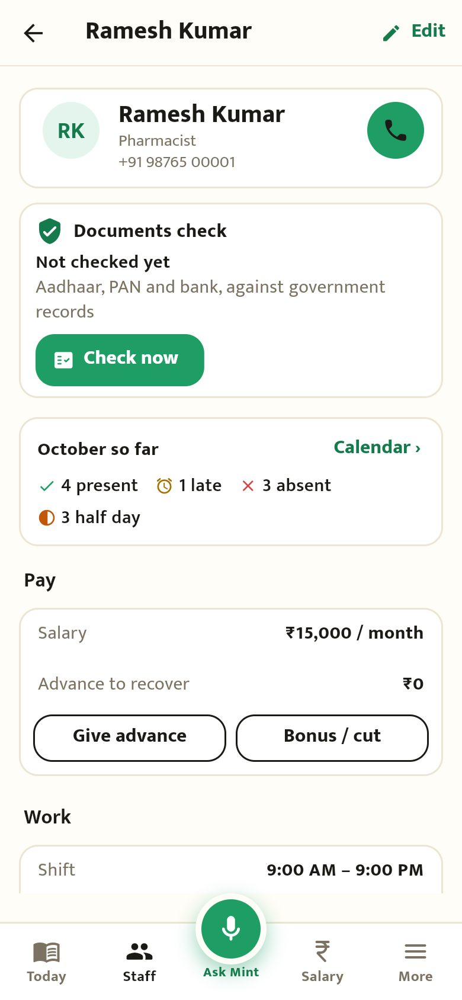 Staff profile: "Documents check · Not checked yet" |  Aadhaar, PAN and bank already ticked; what the plan has left this month | 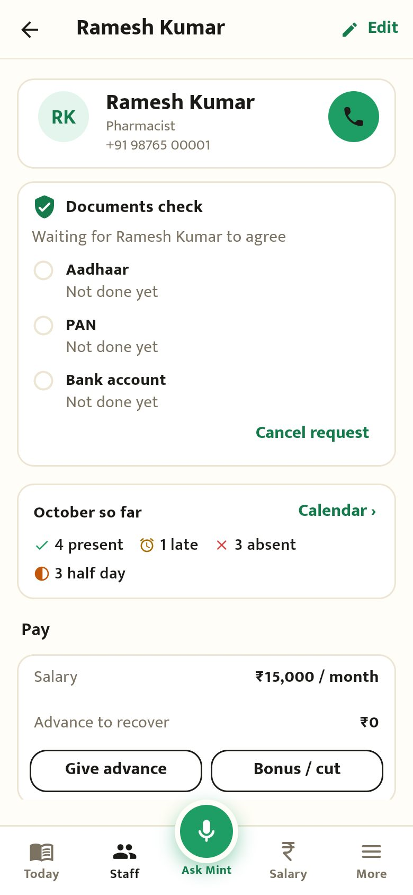 Sent: waiting for them to agree |

## Staff do it on their phone

| | | |
|---|---|---|
| 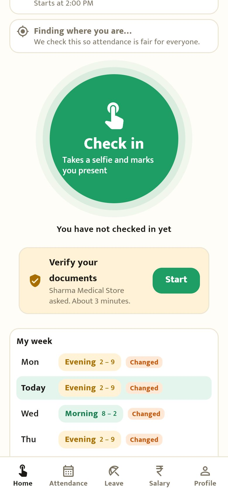 A card on their home screen |  Step 0: what's checked and who sees it, in plain words | 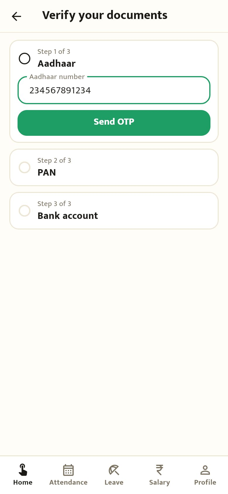 Aadhaar number |
| 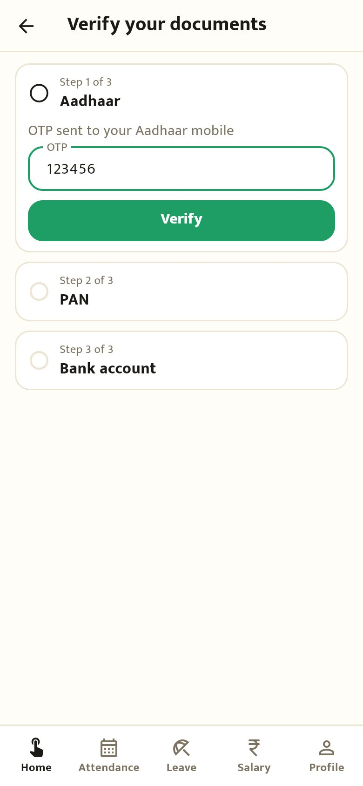 OTP from their Aadhaar mobile | 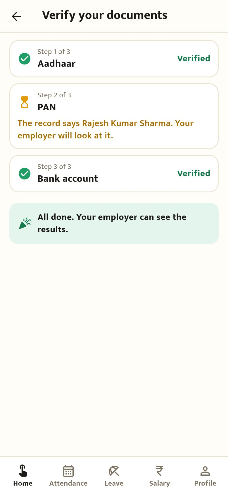 Done; the PAN name didn't match, so the owner will look | |

## Owner sees the result

| | | |
|---|---|---|
|  A name that doesn't match: "This is fine" or "Ask again" | 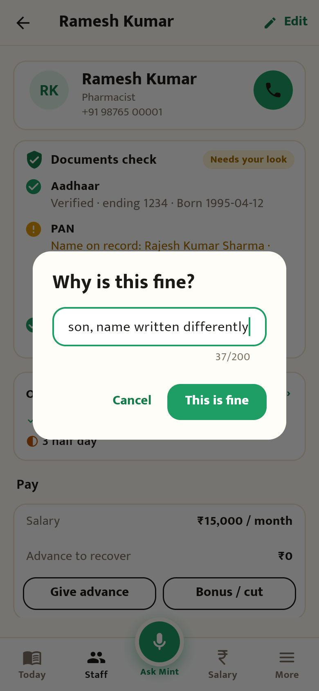 Accept with a reason (kept in History) | 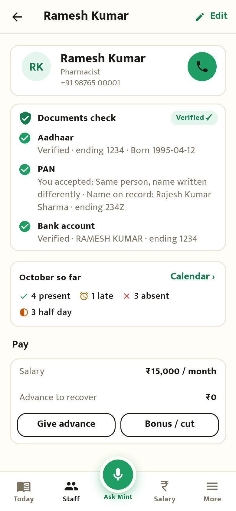 Verified ✓ |
| 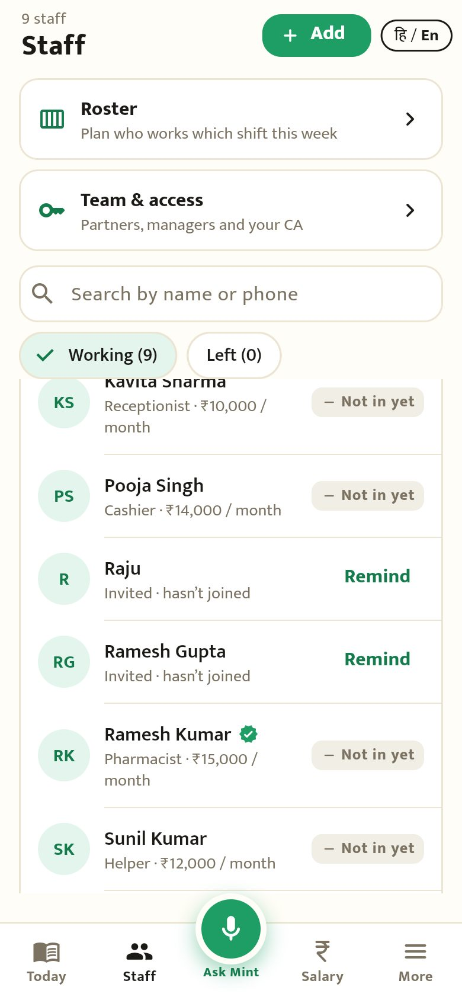 A badge in the staff list | | |

## Hindi

| | | |
|---|---|---|
| 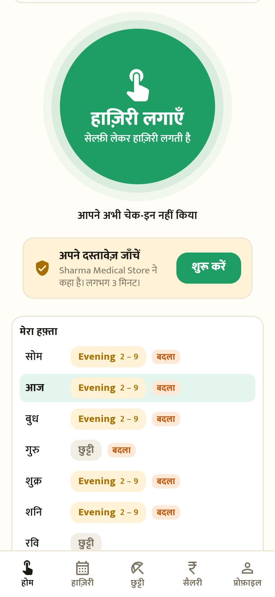 होम पर कार्ड | 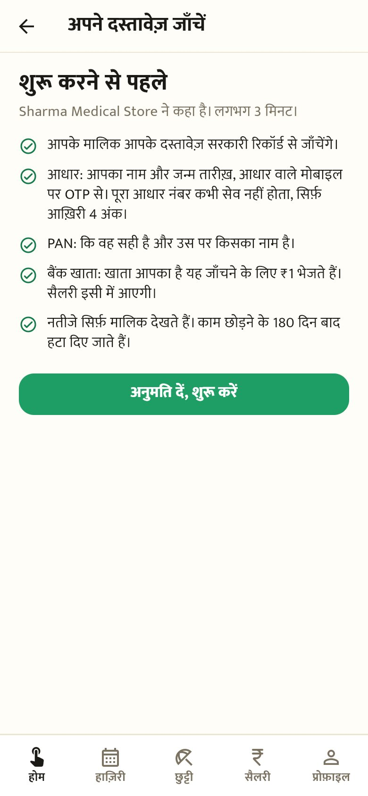 शुरू करने से पहले अनुमति | 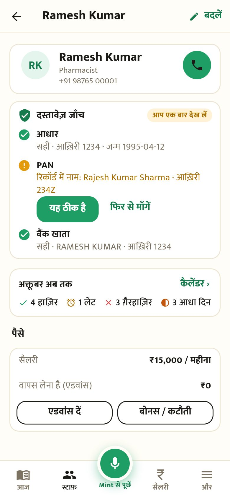 मालिक: नतीजे |
